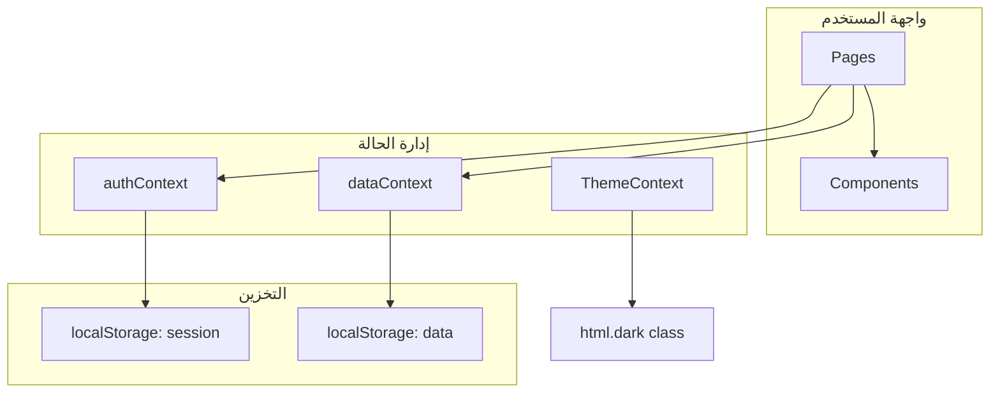
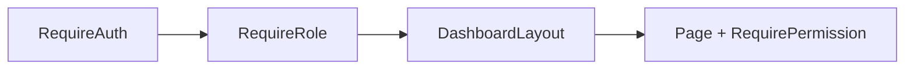
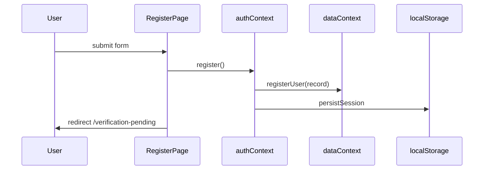
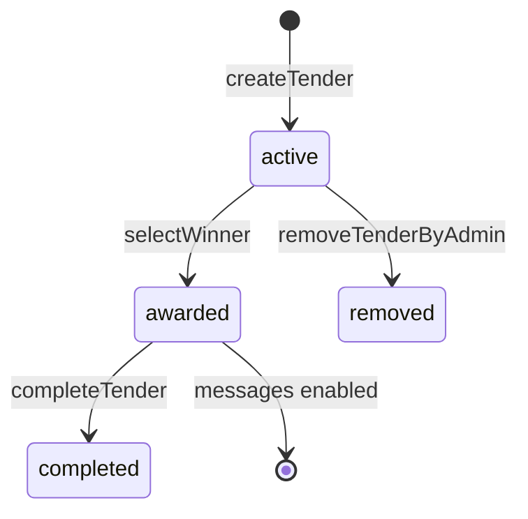

# توثيق مشروع «ركيز» — Tender Dashboard

> **المشروع:** منصة ويب لإدارة المناقصات والعروض  
> **التقنيات:** React 19 · Vite 8 · React Router 7 · Tailwind CSS 3 · localStorage (جاهز لـ Firebase)  
> **اللغة:** واجهة عربية RTL · خط Cairo  
> **تاريخ التوثيق:** يونيو 2026

---

## فهرس المحتويات

1. [نظرة عامة](#1-نظرة-عامة)
2. [هيكلية المشروع](#2-هيكلية-المشروع-project-structure)
3. [التبعيات والإعدادات الجذرية](#3-التبعيات-والإعدادات-الجذرية)
4. [نقطة الدخول والتوجيه](#4-نقطة-الدخول-والتوجيه)
5. [الثوابت والإعدادات](#5-الثوابت-والإعدادات)
6. [السياقات (Contexts)](#6-السياقات-contexts)
7. [الخدمات والأدوات](#7-الخدمات-والأدوات)
8. [مكونات المصادقة](#8-مكونات-المصادقة-auth-components)
9. [مكونات التخطيط](#9-مكونات-التخطيط-layout-components)
10. [مكونات الواجهة (UI)](#10-مكونات-الواجهة-ui-components)
11. [مكونات المناقصات](#11-مكونات-المناقصات)
12. [الصفحات العامة](#12-الصفحات-العامة)
13. [صفحات المصادقة](#13-صفحات-المصادقة)
14. [صفحات المدير (Admin)](#14-صفحات-المدير-admin)
15. [صفحات الشركة الناشئة (Startup)](#15-صفحات-الشركة-الناشئة-startup)
16. [صفحات المورد (Supplier)](#16-صفحات-المورد-supplier)
17. [صفحات مشتركة](#17-صفحات-مشتركة)
18. [نظام الصلاحيات RBAC](#18-نظام-الصلاحيات-rbac)
19. [تدفق البيانات](#19-تدفق-البيانات)
20. [نماذج البيانات](#20-نماذج-البيانات)
21. [الربط المستقبلي مع Firebase](#21-الربط-المستقبلي-مع-firebase)

---

## 1. نظرة عامة

**ركيز** هو تطبيق Single Page Application (SPA) يُدار محلياً عبر `localStorage` ويُ simulat المصادقة والبيانات إلى حين ربط Firebase. يدعم ثلاثة أدوار:

| الدور | المعرف (`role`) | الوظيفة الرئيسية |
|-------|-----------------|------------------|
| مدير النظام | `admin` | إدارة المستخدمين، التصنيفات، المناقصات، النزاعات |
| شركة ناشئة | `startup` | نشر المناقصات، مقارنة العروض، اختيار الفائز، الرسائل |
| مورد | `supplier` | تصفح المناقصات، تقديم العروض، متابعة الفوز، الرسائل |

### مخطط معماري مبسّط



---

## 2. هيكلية المشروع (Project Structure)

```
tender-dashboard/
├── index.html                 # غلاف HTML — RTL، favicon، عنوان «ركيز»
├── package.json               # التبعيات وسكربتات npm
├── vite.config.js             # إعداد Vite
├── tailwind.config.js         # ألوان وخطوط Tailwind
├── postcss.config.js          # PostCSS
├── eslint.config.js           # ESLint
├── public/
│   ├── favicon.svg            # أيقونة العلامة التجارية
│   └── icons.svg              # أصول SVG قديمة (غير مستخدمة كـ favicon)
└── src/
    ├── main.jsx               # نقطة الدخول
    ├── App.jsx                # تعريف المسارات
    ├── index.css              # Tailwind + أنماط RTL/داكن
    ├── config/
    │   └── navigation.js      # عناصر القائمة الجانبية
    ├── constants/
    │   ├── auth.js            # بيانات المدير وحالات الحساب
    │   ├── brand.js           # اسم «ركيز»
    │   └── roles.js           # RBAC
    ├── contexts/
    │   ├── authContext.jsx    # الجلسة والمصادقة
    │   ├── dataContext.jsx    # البيانات المركزية
    │   └── ThemeContext.jsx   # الوضع الليلي/النهاري
    ├── services/
    │   ├── firebase.js        # placeholder لـ Firebase
    │   └── chat.js            # هيكل الدردشة + Firebase docs
    ├── utils/
    │   └── currency.js        # تنسيق الليرة السورية
    ├── components/
    │   ├── auth/              # حراس المسارات
    │   ├── layout/            # Navbar، Sidebar
    │   ├── tenders/           # عرض تفاصيل المناقصة
    │   └── ui/                # مكونات قابلة لإعادة الاستخدام
    └── pages/
        ├── LandingPage.jsx
        ├── DashboardHome.jsx
        ├── ProfilePage.jsx
        ├── MessagesPage.jsx
        ├── UserManagementPage.jsx
        ├── auth/              # login، register، ...
        ├── admin/             # categories، tenders، disputes
        ├── startup/           # tenders، compare
        └── supplier/          # browse، my-bids، won
```

---

## 3. التبعيات والإعدادات الجذرية

### 3.1 `package.json`

| الحقل | الشرح |
|-------|-------|
| `"type": "module"` | استخدام ES Modules في Node/Vite |
| `react` / `react-dom` ^19 | مكتبة الواجهة |
| `react-router-dom` ^7 | التوجيه بين الصفحات |
| `vite` + `@vitejs/plugin-react` | أداة البناء والتطوير |
| `tailwindcss` | Utility-first CSS |

**سكربتات npm:**

| الأمر | الوظيفة |
|-------|---------|
| `npm run dev` | تشغيل خادم التطوير |
| `npm run build` | بناء الإنتاج في `dist/` |
| `npm run preview` | معاينة البناء |
| `npm run lint` | فحص ESLint |

### 3.2 `index.html`

| السطر | الشرح |
|-------|-------|
| `lang="ar" dir="rtl"` | اتجاه عربي من اليمين لليسار |
| `<link rel="icon" href="/favicon.svg">` | أيقونة «ركيز» في تبويب المتصفح |
| `<title>ركيز</title>` | عنوان الصفحة |
| خط Google Fonts — Cairo | الخط الافتراضي للواجهة |
| `<div id="root">` | نقطة تركيب React |
| `<script type="module" src="/src/main.jsx">` | تحميل التطبيق |

### 3.3 `tailwind.config.js`

| الإعداد | القيمة | الغرض |
|---------|--------|-------|
| `darkMode: 'class'` | — | الوضع الداكن عبر class `dark` على `<html>` |
| `content` | `./src/**/*.{js,jsx}` | مسح الملفات لاستخراج classes |
| `fontFamily.sans` | Cairo | خط الواجهة |
| `colors.primary` | `#1d9e75` | اللون الأخضر الرئيسي |
| `colors.surface` | `#faf9f7` | خلفية الصفحات |

### 3.4 `vite.config.js`

```javascript
import { defineConfig } from 'vite'
import react from '@vitejs/plugin-react'

export default defineConfig({
  plugins: [react()],
})
```

يُفعّل `@vitejs/plugin-react` لدعم JSX و Fast Refresh أثناء التطوير.

### 3.5 `src/index.css`

| القسم | الشرح |
|-------|-------|
| `@tailwind base/components/utilities` | استيراد طبقات Tailwind |
| `html { @apply antialiased }` | تنعيم الخط |
| `body` | خلفية `surface`، خط Cairo، حجم 14px |
| `html.dark body` | خلفية داكنة `stone-950` |
| `.bg-surface` / `.bg-surface-muted` | تجاوزات للوضع الداكن |

---

## 4. نقطة الدخول والتوجيه

### 4.1 `src/main.jsx` — سطر بسطر

| السطر | الكود | الشرح |
|-------|-------|-------|
| 1 | `import { StrictMode } from 'react'` | يُفعّل فحوصات React الإضافية في التطوير |
| 2 | `import { createRoot } from 'react-dom/client'` | API React 18+ للتركيب |
| 3 | `import { BrowserRouter } from 'react-router-dom'` | Router يعتمد على History API |
| 4-6 | imports للـ Providers | ترتيب التغليف مهم |
| 7 | `import './index.css'` | تحميل الأنماط العالمية |
| 8 | `import App from './App.jsx'` | المكوّن الجذري |
| 10-21 | `createRoot(...).render(...)` | تركيب الشجرة |

**ترتيب الـ Providers (من الخارج للداخل):**

```
BrowserRouter → ThemeProvider → DataProvider → AuthProvider → App
```

| الترتيب | السبب |
|---------|-------|
| `ThemeProvider` خارجي | يُطبّق المظهر قبل أي render |
| `DataProvider` قبل `AuthProvider` | `AuthProvider` يستدعي `useData()` |
| `AuthProvider` داخل `DataProvider` | يحتاج `registerUser`, `getUserById`, ... |

### 4.2 `src/App.jsx` — المسارات

#### المكوّن `CatchAllRedirect` (أسطر 25–32)

| السطر | المنطق |
|-------|--------|
| `initializing` | يعرض `BootLoader` أثناء استعادة الجلسة |
| `!user` | إعادة توجيه للصفحة الرئيسية `/` |
| `isPending` | إعادة توجيه لـ `/verification-pending` |
| `isActive` | إعادة توجيه لـ `/dashboard` |
| افتراضي | `/login` (حساب محظور مثلاً) |

#### جدول المسارات

| المسار | المكوّن | الحماية |
|--------|---------|---------|
| `/` | `LandingPage` | عام |
| `/login` | `LoginPage` | عام |
| `/register` | `RegisterPage` | عام |
| `/forgot-password` | `ForgotPasswordPage` | عام |
| `/verification-pending` | `VerificationPendingPage` | عام (لكن يُستخدم بعد التسجيل) |
| `/dashboard` | `DashboardHome` | `RequireAuth` → `RequireRole` → `DashboardLayout` |
| `/profile` | `ProfilePage` | محمي |
| `/users` | `UserManagementPage` | محمي — admin فقط |
| `/admin/categories` | `CategoriesPage` | محمي — admin |
| `/admin/tenders` | `AdminTendersPage` | محمي — admin |
| `/admin/disputes` | `DisputeReportsPage` | محمي — admin |
| `/tenders` | `StartupTendersPage` | محمي — startup |
| `/compare` | `CompareBidsPage` | محمي — startup |
| `/compare/:tenderId` | `CompareBidsPage` | محمي — startup |
| `/bidding` | `BrowseTendersPage` | محمي — supplier |
| `/my-bids` | `MyBidsPage` | محمي — supplier |
| `/won-tenders` | `WonTendersPage` | محمي — supplier |
| `/messages` | `MessagesPage` | محمي — startup/supplier |
| `*` | `CatchAllRedirect` | catch-all |

#### تسلسل الحراس (Route Guards)



1. **`RequireAuth`:** يتحقق من وجود `user` في الجلسة
2. **`RequireRole`:** يتحقق من `status` ومسار `pathname`
3. **`RequirePermission`:** داخل كل صفحة — يتحقق من `permission` key

---

## 5. الثوابت والإعدادات

### 5.1 `src/constants/auth.js`

| التصدير | القيمة | الاستخدام |
|---------|--------|-----------|
| `ADMIN_EMAIL` | `admin@platform.com` | بريد المدير الثابت |
| `ADMIN_DEFAULT_PASSWORD` | `Admin@123` | كلمة مرور المدير (محلية) |
| `ACCOUNT_STATUS.PENDING` | `'pending'` | حساب بانتظار التفعيل |
| `ACCOUNT_STATUS.ACTIVE` | `'active'` | حساب مفعّل |
| `ACCOUNT_STATUS.BLOCKED` | `'blocked'` | حساب محظور |
| `ACCOUNT_STATUS_LABELS` | كائن عربي | عرض الحالة في الجداول |

### 5.2 `src/constants/brand.js`

| التصدير | القيمة |
|---------|--------|
| `BRAND_NAME` | `'ركيز'` |
| `BRAND_TAGLINE` | `'إدارة المناقصات والعروض'` |
| `BRAND_FULL` | `'ركيز — إدارة المناقصات والعروض'` |

### 5.3 `src/constants/roles.js`

#### `USER_ROLES`

```javascript
{ ADMIN: 'admin', SUPPLIER: 'supplier', STARTUP: 'startup' }
```

#### `PERMISSIONS` — جدول الصلاحيات

| المفتاح | الأدوار المسموحة |
|---------|------------------|
| `LANDING` | admin, supplier, startup |
| `DASHBOARD` | admin, supplier, startup |
| `PROFILE` | supplier, startup |
| `USER_MANAGEMENT` | admin |
| `ADMIN_TENDERS` | admin |
| `CATEGORIES` | admin |
| `STARTUP_TENDERS` | startup |
| `COMPARISON` | startup |
| `BIDDING_MARKET` | supplier |
| `MY_BIDS` | supplier |
| `WON_TENDERS` | supplier |
| `MESSAGES` | supplier, startup |
| `DISPUTES` | admin |

#### دوال مساعدة

| الدالة | الوظيفة |
|--------|---------|
| `roleCan(role, permissionKey)` | هل الدور يملك صلاحية؟ |
| `roleMayAccessPath(role, pathname)` | هل المسار مسموح للدور؟ |
| `normalizePathname(pathname)` | إزالة `/` الزائدة و query/hash |

**`ROLE_ALLOWED_PATHS`:** قائمة صريحة لكل دور — تمنع التداخل بين مسارات متشابهة (مثل `/tenders` للـ startup و `/admin/tenders` للـ admin).

### 5.4 `src/config/navigation.js`

**`ALL_NAV_ITEMS`:** مصفوفة عناصر القائمة، كل عنصر:

| الحقل | مثال | الشرح |
|-------|------|-------|
| `id` | `'dashboard'` | معرّف فريد |
| `label` | `'لوحة التحكم'` | النص العربي |
| `path` | `'/dashboard'` | مسار React Router |
| `permission` | `'DASHBOARD'` | مفتاح في `PERMISSIONS` |
| `icon` | `'dashboard'` | اسم أيقونة في `DashboardLayout` |

**`getNavItemsForRole(role)`:**

```javascript
return ALL_NAV_ITEMS.filter((item) => PERMISSIONS[item.permission]?.includes(role))
```

---

## 6. السياقات (Contexts)

### 6.1 `src/contexts/ThemeContext.jsx`

#### الوظيفة
إدارة الوضع الليلي/النهاري وتطبيق class `dark` على `<html>`.

#### شرح الأسطر الأساسية

| السطر/الدالة | الشرح |
|--------------|-------|
| `THEME_STORAGE_KEY = 'rakeez_theme_v1'` | مفتاح localStorage |
| `getInitialTheme()` | يقرأ المحفوظ أو `prefers-color-scheme` |
| `applyTheme(theme)` | يضيف/يزيل `dark` على `document.documentElement` |
| `useState(getInitialTheme)` | الحالة الأولية عند التحميل |
| `useEffect` على `[theme]` | يطبّق ويحفظ عند التغيير |
| `toggleTheme()` | تبديل بين `dark` و `light` |

#### القيم المُصدّرة عبر `useTheme()`

| الخاصية | النوع | الشرح |
|---------|-------|-------|
| `theme` | `'light' \| 'dark'` | القيمة الحالية |
| `isDark` | `boolean` | اختصار |
| `setTheme` | `function` | تعيين مباشر |
| `toggleTheme` | `function` | تبديل |

**التفاعل:** يُستخدم في `ThemeToggle`, `DashboardLayout`, وجميع الصفحات عبر classes `dark:*` في Tailwind.

---

### 6.2 `src/contexts/dataContext.jsx`

#### الوظيفة
**مصدر الحقيقة الوحيد** لبيانات التطبيق (مستخدمون، مناقصات، عروض، نزاعات، رسائل). يُ persist في `localStorage` تحت المفتاح `tender_platform_data_v1`.

#### البيانات الافتراضية (`defaultData`)

| المجموعة | الحقول | الوصف |
|----------|--------|-------|
| `categories` | `{ id, name }[]` | تصنيفات المناقصات |
| `users` | سجل المستخدمين المسجّلين | بدون المدير |
| `tenders` | المناقصات | |
| `bids` | العروض | |
| `disputes` | النزاعات | |
| `messages` | رسائل الدردشة | |

#### دوال التحميل والحفظ

| الدالة | الشرح |
|--------|-------|
| `loadData()` | `JSON.parse` من localStorage أو `defaultData` |
| `persistData(data)` | `JSON.stringify` → localStorage |
| `useEffect([data])` | حفظ تلقائي عند أي تغيير |

#### عمليات CRUD — جدول شامل

| الدالة | المعاملات | التأثير |
|--------|-----------|---------|
| `addCategory(name)` | نص | يُنشئ `cat-{timestamp}` |
| `removeCategory(id)` | id | يحذف من المصفوفة |
| `registerUser(userRecord)` | كائن مستخدم | يضيف لـ `users` |
| `findUserByEmail(email)` | email | بحث case-insensitive |
| `updateUserStatus(uid, status)` | uid, status | pending/active/blocked |
| `updateUserProfile(uid, profile)` | uid, profile | يضبط `profileComplete: true` |
| `getUserById(uid)` | uid | |
| `createTender(tender)` | كائن | id: `tnd-{ts}`, status: `active` |
| `updateTender(id, patch)` | id, patch | merge |
| `deleteTender(id)` | id | يحذف المناقصة + عروضها |
| `removeTenderByAdmin(id, reason)` | id, reason | status: `removed` |
| `createBid(bid)` | كائن | id: `bid-{ts}`, status: `pending` |
| `updateBid(id, patch)` | | |
| `deleteBid(id)` | | |
| `selectWinner(tenderId, bidId)` | | tender→`awarded`, bid→`won`, الباقي→`rejected` + رسالة نظام |
| `completeTender(tenderId)` | | status→`completed` |
| `createDispute(dispute)` | | id: `dsp-{ts}` |
| `updateDisputeStatus(id, status)` | | |

#### دوال الاستعلام

| الدالة | المنطق |
|--------|--------|
| `getTendersByOwner(ownerId)` | مناقصات المالك، بدون `removed` |
| `getActiveTenders()` | `status === 'active'` |
| `getBidsForTender(tenderId)` | |
| `getBidsBySupplier(supplierId)` | |
| `getWonBids(supplierId)` | `status === 'won'` |
| `hasSupplierBidOnTender(supplierId, tenderId)` | boolean |
| `canAccessMessages(userId, role)` | startup: مناقصة بفائز؛ supplier: عرض فائز |

#### نظام الرسائل

| الدالة | الشرح |
|--------|-------|
| `getConversationsForUser(userId, role)` | يبني قائمة محادثات من المناقصات الفائزة |
| `getMessagesForConversation(conversationId)` | رسائل مرتبة زمنياً |
| `sendMessage(conversationId, senderId, text)` | يضيف `{ id, conversationId, senderId, text, createdAt }` |

**`selectWinner` — سلوك خاص:**

عند اختيار الفائز يُنشأ `conversationId = conv-{tenderId}` ورسالة نظام ترحيبية تُضاف لـ `messages`.

#### `stats` (useMemo)

| الحقل | الحساب |
|-------|--------|
| `usersCount` | `users.length` |
| `activeTenders` | مناقصات `active` |
| `totalBids` | `bids.length` |
| `categoriesCount` | |
| `pendingUsers` | `status === pending` |

**التفاعل:** تستهلكه جميع الصفحات عبر `useData()`. `authContext` يعتمد عليه لـ `registerUser`, `updateUserProfile`, ...

---

### 6.3 `src/contexts/authContext.jsx`

#### الوظيفة
إدارة **الجلسة الحالية** (`user`) منفصلة عن مخزن البيانات. الجلسة في `localStorage` تحت `tender_platform_session_v3`.

#### دوال مساعدة داخلية

| الدالة | الشرح |
|--------|-------|
| `isAdminEmail(email)` | مقارنة مع `ADMIN_EMAIL` |
| `computeProfileComplete(user)` | admin دائماً true؛ غيره يتحقق من profile |
| `mergeUserFromStore(sessionUser, getUserById)` | دمج الجلسة مع أحدث بيانات من `dataContext` |
| `sessionUsersEqual(a, b)` | يمنع re-render غير ضروري |

#### `useEffect` التحميل الأولي (أسطر 72–91)

1. يقرأ `SESSION_KEY` من localStorage
2. إن وُجد `uid` و `role`:
   - admin: يضبط مباشرة
   - غير admin: `mergeUserFromStore`
3. `setInitializing(false)`

#### `login({ email, password })`

| الفرع | السلوك |
|-------|--------|
| بريد المدير | يتحقق من `ADMIN_DEFAULT_PASSWORD` → جلسة admin |
| مستخدم مسجّل | يتحقق من كلمة المرور |
| `BLOCKED` | يرمي خطأ |
| `PENDING` | redirect: `/verification-pending` |
| `ACTIVE` | redirect: `/dashboard` |

#### `register({ role, companyName, email, password })`

1. يرفض بريد المدير
2. يرفض البريد المكرر
3. ينشئ `uid: usr_{role}_{timestamp}`
4. `status: pending`, `profileComplete: false`
5. `registerUser` + `persistSession`

#### `saveProfile(profile)`

- يستدعي `updateUserProfile` في dataContext
- يحدّث الجلسة محلياً مع `profileComplete: true`

#### `refreshUserFromStore()`

- يُستخدم في `VerificationPendingPage` كل 5 ثوانٍ
- `setUser` functional مع `sessionUsersEqual` لمنع infinite loop

#### القيم المُصدّرة

| الخاصية | الشرح |
|---------|-------|
| `user` | كائن الجلسة |
| `role` | `user?.role` |
| `status` | `user?.status` |
| `initializing` | true أثناء استعادة الجلسة |
| `login`, `register`, `logout` | |
| `saveProfile` | |
| `activateUser`, `blockUser` | للمدير |
| `refreshUserFromStore` | |
| `canAccess(permissionKey)` | wrapper على `roleCan` |
| `isAuthenticated` | `Boolean(user)` |
| `isProfileComplete` | |
| `isActive` | active أو admin |
| `isPending` | |

---

## 7. الخدمات والأدوات

### 7.1 `src/utils/currency.js`

| التصدير | الشرح |
|---------|-------|
| `CURRENCY_LABEL` | `'ل.س'` |
| `CURRENCY_CODE` | `'SYP'` |
| `formatSYP(amount)` | `Intl.NumberFormat('ar-SY')` + تسمية |
| `formatSYPRange(min, max)` | `"1,000 – 5,000 ل.س"` |

**مثال:** `formatSYP(1500000)` → `"1,500,000 ل.س"`

### 7.2 `src/services/firebase.js`

Placeholder — `firebaseReady = false`. يحتوي `firebaseConfigPlaceholder` للحقول المطلوبة عند التكامل.

### 7.3 `src/services/chat.js`

| التصدير | الشرح |
|---------|-------|
| `conversationIdForTender(tenderId)` | `'conv-' + tenderId` |
| `isFirebaseChatEnabled()` | `firebaseReady` |
| تعليقات JSDoc | هيكل Firestore: `conversations/{id}/messages/{id}` |

---

## 8. مكونات المصادقة (Auth Components)

### 8.1 `RequireAuth.jsx`

```jsx
if (initializing) return <BootLoader />
if (!user) return <Navigate to="/login" replace />
return <Outlet />
```

- **`Outlet`:** يعرض المسارات الفرعية (nested routes)
- **التفاعل:** أول حارس في سلسلة `/dashboard/*`

### 8.2 `RequireRole.jsx`

| الشرط | الإجراء |
|-------|---------|
| `initializing` | `BootLoader` |
| `!user` | `/login` |
| غير admin + `isPending` | `/verification-pending` |
| غير admin + `!isActive` | `/login` مع `state.blocked` |
| `!roleMayAccessPath(role, pathname)` | `/dashboard` |
| else | `<Outlet />` |

### 8.3 `RequirePermission.jsx`

يُلف **محتوى الصفحة** (children) وليس `<Outlet>`:

```jsx
if (!canAccess(permission)) return <Navigate to="/dashboard" />
return children
```

### 8.4 `AuthShell.jsx`

غلاف بصري لصفحات login/register/forgot/verification:

- خلفية gradient
- بطاقة مركزية `rounded-2xl`
- `RakeezLogo` + `BRAND_NAME`
- `title`, `subtitle`, `children`

### 8.5 `ProtectedRoutes.jsx`

Barrel file — re-export لـ `RequireAuth` و `RequirePermission` (للاستيراد المختصر).

---

## 9. مكونات التخطيط (Layout Components)

### 9.1 `PlatformBrand.jsx`

| العنصر | الشرح |
|--------|-------|
| `<Link to="/">` | العودة للصفحة الرئيسية |
| `<RakeezLogo size={40}>` | الأيقونة |
| `BRAND_NAME` + `BRAND_TAGLINE` | النص (يُخفى عند `compact`) |

### 9.2 `RakeezLogo.jsx`

```jsx

```

صورة SVG من `public/` — تُستخدم في Brand, AuthShell, BootLoader.

### 9.3 `Navbar.jsx`

**الصفحة العامة فقط** (LandingPage):

| القسم | المحتوى |
|-------|---------|
| يسار | `PlatformBrand` |
| وسط | روابط anchor (#stats, #how, ...) |
| يمين | `ThemeToggle` + login/register أو dashboard/logout |

**`showDashboard`:** يظهر زر لوحة التحكم إذا المستخدم admin أو active.

### 9.4 `DashboardLayout.jsx`

#### `NavIcon({ name, active })`

Switch على `name` — يرجع SVG مناسب (landing, dashboard, users, file, search, ...).

#### الهيكل

```
┌─────────────┬──────────────────────────┐
│   Sidebar   │  Header (user + theme)   │
│   (nav)     ├──────────────────────────┤
│             │  Mobile nav pills        │
│             ├──────────────────────────┤
│             │  <Outlet /> — المحتوى    │
└─────────────┴──────────────────────────┘
```

| الجزء | responsive |
|-------|------------|
| Sidebar | `hidden md:flex` |
| Mobile pills | `md:hidden` |
| `getNavItemsForRole(role)` | عناصر ديناميكية |

**التفاعل:** `useAuth()` للمستخدم و logout؛ `Outlet` يعرض الصفحة الحالية.

---

## 10. مكونات الواجهة (UI Components)

### 10.1 `FormField.jsx`

#### `FormField` component

| prop | الشرح |
|------|-------|
| `label` | نص `<label>` |
| `id` | `htmlFor` |
| `children` | input/select/textarea |
| `hint` | نص مساعد |
| `error` | رسالة خطأ حمراء |

#### Classes المُصدّرة (أزرار)

| Class | اللون | الاستخدام |
|-------|-------|-----------|
| `inputClass` | neutral | حقول الإدخال |
| `btnPrimary` | أخضر primary | إجراء رئيسي |
| `btnOutline` | حدود رمادية | إلغاء / ثانوي |
| `btnDanger` | أحمر | حذف |
| `btnSuccess` | emerald | تأكيد نجاح |
| `btnWarning` | amber | تحذير |
| `btnInfo` | sky | معلومات |
| `btnDangerSm` | أحمر صغير | جداول |

### 10.2 `Alert.jsx`

| prop | القيم |
|------|-------|
| `variant` | `info` \| `warning` \| `error` \| `success` |
| `title` | عنوان اختياري |
| `children` | المحتوى |
| `onDismiss` | زر إغلاق اختياري |

**التصميم:** gradient background، أيقونة دائرية، شريط accent جانبي، دعم `dark:`.

### 10.3 `Modal.jsx`

| prop | الشرح |
|------|-------|
| `open` | boolean — إن false يرجع null |
| `onClose` | عند النقر على الخلفية أو ✕ |
| `title` | عنوان الـ dialog |
| `children` | المحتوى (scroll max 70vh) |
| `footer` | أزرار الإجراء |
| `size` | `'md'` (default) أو `'lg'` |

**إمكانية الوصول:** `role="dialog"`, `aria-modal`, `aria-labelledby`.

### 10.4 `ConfirmDialog.jsx`

يُلف `Modal` + `ConfirmBody`:

| prop | الشرح |
|------|-------|
| `variant` | danger / warning / success / info |
| `onConfirm` | callback التأكيد |
| `confirmLabel`, `cancelLabel` | نص الأزرار |
| `loading` | تعطيل الأزرار |

### 10.5 `SearchFilterBar.jsx`

| prop | الشرح |
|------|-------|
| `searchValue`, `onSearchChange` | controlled search |
| `searchPlaceholder` | |
| `filters` | `[{ id, label, value, onChange, options }]` |

**`matchesSearch(text, query)`:** case-insensitive includes — تُستخدم في useMemo للفلترة.

### 10.6 `ThemeToggle.jsx`

زر sun/moon يستدعي `toggleTheme()` من `useTheme()`.

### 10.7 `BootLoader.jsx`

شاشة تحميل: `RakeezLogo` + spinner — أثناء `initializing`.

---

## 11. مكونات المناقصات

### `TenderDetailContent.jsx`

**Props:** `tender`, `categories`, `owner`

| القسم | المحتوى |
|-------|---------|
| Header | عنوان + اسم الشركة |
| `<dl>` | تصنيف، حالة، ميزانية (`formatSYPRange`)، deadline، تاريخ النشر |
| الوصف | `whitespace-pre-wrap` |

**`DetailItem`:** sub-component لصف label/value.

**يُستخدم في:** BrowseTendersPage, MyBidsPage, DisputeReportsPage (modal).

---

## 12. الصفحات العامة

### 12.1 `LandingPage.jsx`

#### الوظيفة
الصفحة التسويقية العامة — أول ما يراه الزائر.

#### الثوابت

| الثابت | المحتوى |
|--------|---------|
| `STEPS` | 4 خطوات (تسجيل → ملف → نشر/تقديم → مقارنة) |
| `AUDIENCES` | شركات ناشئة vs موردون |
| `FAQ` | أسئلة شائعة |

#### الأقسام

| Section | id | الشرح |
|---------|-----|-------|
| Hero | — | عنوان `BRAND_TAGLINE`، أزرار register/login |
| Stats | `#stats` | `stats` من dataContext |
| How it works | `#how` | STEPS |
| Audiences | `#audience` | AudienceGrid |
| FAQ | `#faq` | `<details>` accordion |
| Footer | — | `BRAND_FULL` + IPI405 |

#### `StatCard`, `AudienceGrid`

مكونات داخلية للعرض — لا state.

**التفاعل:** `Navbar`, `useData().stats`, `Link` إلى `/register`, `/login`.

---

## 13. صفحات المصادقة

### 13.1 `LoginPage.jsx`

| State | النوع | الغرض |
|-------|-------|-------|
| `email`, `password` | string | controlled inputs |
| `error` | string | رسالة خطأ |
| `loading` | boolean | تعطيل الزر |

**Guard:** إن `user` موجود → redirect حسب `isPending` / `isActive`.

**`onSubmit`:** `login()` → `navigate(redirect)`.

**حالة خاصة:** `location.state?.blocked` — Alert عند حظر الحساب.

### 13.2 `RegisterPage.jsx`

| State | الغرض |
|-------|-------|
| `role` | startup أو supplier (radio) |
| `companyName`, `email`, `password`, `confirm` | |
| `error`, `loading` | |

**Validation:**
- تطابق كلمتي المرور
- طول ≥ 6

**بعد النجاح:** `/verification-pending`

### 13.3 `VerificationPendingPage.jsx`

```javascript
useEffect(() => {
  refreshUserFromStore()
  const id = setInterval(refreshUserFromStore, 5000)
  return () => clearInterval(id)
}, [refreshUserFromStore])
```

**Redirects:**
- لا user → `/login`
- `isActive` → `/dashboard`
- status ≠ pending → `/login`

### 13.4 `ForgotPasswordPage.jsx`

نموذج simulated — يعرض Alert نجاح بدون backend حقيقي. جاهز لـ Firebase `sendPasswordResetEmail`.

---

## 14. صفحات المدير (Admin)

### 14.1 `UserManagementPage.jsx`

**Permission:** `USER_MANAGEMENT`

| الميزة | التفاصيل |
|--------|----------|
| جدول المستخدمين | من `dataContext.users` |
| `SearchFilterBar` | بحث + فلتر status/role |
| تفعيل | `activateUser(uid)` |
| حظر | `blockUser(uid)` + ConfirmDialog |
| `btnDangerSm` | زر الحظر |

### 14.2 `CategoriesPage.jsx`

**Permission:** `CATEGORIES`

| الإجراء | الدالة |
|---------|--------|
| إضافة | `addCategory(name)` |
| حذف | `removeCategory(id)` + `btnDangerSm` |

### 14.3 `AdminTendersPage.jsx`

**Permission:** `ADMIN_TENDERS`

- جدول كل `tenders`
- Modal إزالة مع `reason` إلزامي
- `removeTenderByAdmin(id, reason)`

### 14.4 `DisputeReportsPage.jsx`

**Permission:** `DISPUTES`

| State | الغرض |
|-------|-------|
| `search`, `statusFilter` | فلترة |
| `selected` | نزاع في Modal |
| `resolveTarget` | ConfirmDialog |

**`DisputeDetailBody`:** معلومات النزاع + `PartyCard` + `TenderDetailContent`.

**`updateDisputeStatus(id, 'resolved')`:** عند التأكيد.

---

## 15. صفحات الشركة الناشئة (Startup)

### 15.1 `StartupTendersPage.jsx`

**Permission:** `STARTUP_TENDERS`

#### State

| State | الغرض |
|-------|-------|
| `open`, `editing`, `form` | Modal إنشاء/تعديل |
| `search`, `statusFilter`, `categoryFilter` | فلترة |
| `deleteTarget` | ConfirmDialog حذف |

#### `filtered` (useMemo)

```javascript
tenders.filter(t =>
  matchesStatus && matchesCat &&
  (matchesSearch(title) || matchesSearch(description) || matchesSearch(catName))
)
```

#### `onSubmit`

- يتحقق `isProfileComplete`
- `createTender` أو `updateTender`
- `ownerId: user.uid`

#### قيود

- لا تعديل/حذف إذا `awarded` أو `completed`
- Alert إن الملف غير مكتمل

**التفاعل:** `getTendersByOwner`, `categories`, modals, `ConfirmDialog variant="danger"`.

### 15.2 `CompareBidsPage.jsx`

**Permission:** `COMPARISON`

#### Params

`useParams().tenderId` — اختيار المناقصة؛ fallback لأول مناقصة.

#### التدفق

1. عرض جدول العروض (`getBidsForTender`)
2. Modal تفاصيل عرض (`selectedBid`)
3. `selectWinner(tenderId, bidId)` — ConfirmDialog
4. بعد `awarded`: زر `completeTender` — ConfirmDialog

**التفاعل:** عند `selectWinner` → تُنشأ محادثة في `messages` → تُفعّل `/messages`.

---

## 16. صفحات المورد (Supplier)

### 16.1 `BrowseTendersPage.jsx`

**Permission:** `BIDDING_MARKET`

#### فلترة المناقصات

```javascript
getActiveTenders().filter(t =>
  !supplierCategory || t.categoryId === supplierCategory
)
```

المورد يرى مناقصات **تصنيفه** فقط (إن وُجد في profile).

#### Modals

| Modal | الغرض |
|-------|-------|
| `detailTender` | `TenderDetailContent` |
| `bidTender` | نموذج تقديم عرض |

#### `submitBid`

```javascript
createBid({
  tenderId, supplierId: user.uid,
  price, plan, deliveryDate, message
})
```

**`hasSupplierBidOnTender`:** يمنع التقديم المكرر.

### 16.2 `MyBidsPage.jsx` (supplier)

**Permission:** `MY_BIDS`

- جدول `getBidsBySupplier(user.uid)`
- تعديل/حذف فقط إذا `status === 'pending'`
- Modal تفاصيل المناقصة
- Modal تعديل العرض

### 16.3 `WonTendersPage.jsx`

**Permission:** `WON_TENDERS`

- قائمة `getWonBids(user.uid)`
- رابط `/messages`
- Modal تقديم نزاع → `createDispute({ tenderId, complainantId, defendantId, description })`

---

## 17. صفحات مشتركة

### 17.1 `DashboardHome.jsx`

**Permission:** ضمن `DASHBOARD` (RequireRole)

| الدور | البطاقات |
|-------|----------|
| Admin | users, active tenders, bids, categories |
| Startup | مناقصاتي، عروض مستلمة، مُنحت |
| Supplier | عروضي، قيد الانتظار، فوزت بـ |

**تنبيه:** رابط `/profile` إن `!isProfileComplete`.

### 17.2 `ProfilePage.jsx`

**Permission:** `PROFILE`

| حقل | مطلوب |
|------|-------|
| companyName | ✓ |
| categoryId | ✓ (select من categories) |
| website | |
| bio | ✓ |
| phone | ✓ |

**`saveProfile(form)`** → authContext + dataContext.

### 17.3 `MessagesPage.jsx`

**Permission:** `MESSAGES`

#### هيكل

```
┌─────────────────┬─────────────────────────┐
│ ConversationList│ ChatPanel               │
│ (sidebar)       │ header + bubbles + form │
└─────────────────┴─────────────────────────┘
```

#### State

| State | الغرض |
|-------|-------|
| `activeId` | المحادثة المختارة |
| `draft` | نص الرسالة |

#### `MessageBubble`

| نوع | التنسيق |
|-----|---------|
| `senderId === 'system'` | pill مركزي رمادي |
| `isOwn` | أخضر primary، justify-start (RTL) |
| other | أبيض/داكن، justify-end |

**`handleSend`:** `sendMessage(conversationId, user.uid, draft)`

**Alert:** تحذير وضع localStorage حتى Firebase.

---

## 18. نظام الصلاحيات RBAC

### مصفوفة الدور × الصفحة

| الصفحة | Admin | Startup | Supplier |
|--------|:-----:|:-------:|:--------:|
| `/dashboard` | ✓ | ✓ | ✓ |
| `/users` | ✓ | ✗ | ✗ |
| `/admin/*` | ✓ | ✗ | ✗ |
| `/tenders`, `/compare` | ✗ | ✓ | ✗ |
| `/bidding`, `/my-bids`, `/won-tenders` | ✗ | ✗ | ✓ |
| `/profile` | ✗ | ✓ | ✓ |
| `/messages` | ✗ | ✓* | ✓* |

\* بعد اختيار/الفوز بعرض

### طبقات الحماية

1. **Route level:** `RequireAuth` + `RequireRole`
2. **Page level:** `RequirePermission`
3. **Business logic:** `isProfileComplete`, `canAccessMessages`

---

## 19. تدفق البيانات

### تسجيل مستخدم جديد



### دورة المناقصة



### تقديم عرض

```
BrowseTendersPage → createBid → dataContext.bids
CompareBidsPage → selectWinner → tender.awarded + bid.won + message
MessagesPage → sendMessage → dataContext.messages
```

---

## 20. نماذج البيانات

### User (مسجّل)

```typescript
{
  uid: string           // usr_startup_1738...
  email: string
  password: string      // ⚠ plain text — يُستبدل بـ Firebase Auth
  role: 'startup' | 'supplier'
  companyName: string
  displayName: string
  status: 'pending' | 'active' | 'blocked'
  profileComplete: boolean
  profile: {
    companyName?: string
    categoryId?: string
    website?: string
    bio?: string
    phone?: string
  }
  createdAt: string     // ISO
}
```

### Tender

```typescript
{
  id: string              // tnd-...
  ownerId: string
  title: string
  categoryId: string
  description: string
  budgetMin: number
  budgetMax: number
  deadline: string
  status: 'active' | 'awarded' | 'completed' | 'removed'
  winnerBidId: string | null
  removalReason: string | null
  createdAt: string
  completedAt?: string
}
```

### Bid

```typescript
{
  id: string              // bid-...
  tenderId: string
  supplierId: string
  price: number
  plan: string
  deliveryDate: string
  message: string
  status: 'pending' | 'won' | 'rejected'
  createdAt: string
}
```

### Dispute

```typescript
{
  id: string              // dsp-...
  tenderId: string
  complainantId: string
  defendantId: string
  description: string
  status: 'pending' | 'resolved'
  createdAt: string
  resolvedAt?: string
}
```

### Message

```typescript
{
  id: string              // msg-...
  conversationId: string  // conv-{tenderId}
  senderId: string        // uid أو 'system'
  text: string
  createdAt: string       // ISO
}
```

---

## 21. الربط المستقبلي مع Firebase

### خطوات مقترحة

| # | المهمة | الملفات المتأثرة |
|---|--------|------------------|
| 1 | `npm install firebase` | package.json |
| 2 | تهيئة `initializeApp`, `getAuth`, `getFirestore` | services/firebase.js |
| 3 | استبدال login/register | authContext.jsx |
| 4 | استبدال dataContext | collections: users, tenders, bids, ... |
| 5 | Realtime chat | services/chat.js + MessagesPage |
| 6 | Custom Claims للـ RBAC | roles.js + Cloud Functions |

### Collections Firestore المقترحة

```
users/{uid}
categories/{id}
tenders/{id}
bids/{id}
disputes/{id}
conversations/{id}
  └── messages/{id}
```

### مفاتيح localStorage الحالية (للمرجع)

| المفتاح | المحتوى |
|---------|---------|
| `tender_platform_session_v3` | جلسة المستخدم |
| `tender_platform_data_v1` | كل البيانات |
| `rakeez_theme_v1` | light/dark |

---

## ملحق: حسابات تجريبية

| الدور | البريد | كلمة المرور |
|-------|--------|-------------|
| Admin | `admin@platform.com` | `Admin@123` |
| Startup/Supplier | — | يُسجّل عبر `/register` ثم يُفعّل من `/users` |

---

## ملحق: ملفات legacy / غير مستخدمة

| الملف | الحالة |
|-------|--------|
| `src/pages/MyBidsPage.jsx` | mock قديم — **غير مربوط** في App.jsx |
| `public/icons.svg` | أصول Vite template — غير favicon |

---

*نهاية التوثيق — مشروع تخرج IPI405 — جامعة سوريا الافتراضية*

---

# ملحق أ: شرح سطر بسطر للملفات الأساسية

## أ.1 `src/contexts/dataContext.jsx` — الأسطر 1–60

| السطر | الكود | الشرح التفصيلي |
|-------|-------|----------------|
| 1–8 | `import { createContext, useCallback, ... }` | استيراد Hooks لبناء Context مع memoization |
| 9–10 | `import ACCOUNT_STATUS`, `USER_ROLES` | ثوابت الحالة والأدوار |
| 11 | `import conversationIdForTender` | ربط الدردشة بمعرّف المناقصة |
| 13 | `DATA_STORAGE_KEY` | مفتاح localStorage — الإصدار v1 |
| 15–29 | `defaultData` | البيانات الأولية عند أول تشغيل |
| 16–19 | categories افتراضية | 3 تصنيفات: IT، تسويق، لوجستية |
| 29 | `const DataContext = createContext(null)` | إنشاء Context فارغ |
| 31–38 | `loadData()` | try/catch — merge مع defaultData |
| 41–43 | `persistData()` | JSON.stringify → setItem |
| 45–46 | `useState(loadData)` | الحالة المركزية للتطبيق |
| 48–50 | `useEffect([data])` | **كل تغيير** يُحفظ تلقائياً |
| 52–57 | destructuring | slices: categories, users, tenders, bids, disputes, messages |

## أ.2 `selectWinner` — الأسطر 164–176

```javascript
const selectWinner = useCallback((tenderId, bidId) => {
  const conversationId = conversationIdForTender(tenderId)  // conv-tnd-xxx
  const welcome = { id, conversationId, senderId: 'system', text, createdAt }
  setData((prev) => ({
    tenders: ... status awarded + winnerBidId,
    bids: ... won/rejected,
    messages: [...prev.messages, welcome],  // رسالة ترحيب تلقائية
  }))
}, [])
```

**التفاعل:** يُفعّل `canAccessMessages` → تظهر المحادثة في `MessagesPage`.

## أ.3 `getConversationsForUser` — المنطق

**Startup:** لكل tender حيث `ownerId === userId` و `winnerBidId` موجود:
- يجلب `winningBid` → `supplier`
- يبني `{ id, tenderTitle, partnerName, lastMessage, updatedAt }`

**Supplier:** لكل bid حيث `status === 'won'`:
- يجلب `tender` → `owner`
- نفس بنية المحادثة

**الترتيب:** `sort` حسب `updatedAt` تنازلياً.

---

## أ.4 `src/pages/MessagesPage.jsx` — سطر بسطر

| السطر | الشرح |
|-------|-------|
| 1 | `useRef` للتمرير التلقائي لآخر رسالة |
| 15–17 | جلب user, role من auth + دوال الدردشة من data |
| 19 | `allowed` — هل يحق للمستخدم الدخول؟ |
| 20–23 | `useMemo` — قائمة المحادثات (تُعاد حسابها عند تغيير allowed/user/role) |
| 25–26 | state: المحادثة النشطة + نص الإدخال |
| 28–29 | fallback للمحادثة الأولى إن لم يُختر activeId |
| 31–34 | رسائل المحادثة النشطة فقط |
| 36–40 | `useEffect` — auto-select أول محادثة |
| 42–47 | `handleSend` — preventDefault → sendMessage → clear draft |
| 59–62 | Alert إن غير مسموح |
| 65–70 | تحذير localStorage vs Firebase |
| 72–87 | Grid: ConversationList (1 col) + ChatPanel (2 cols) |
| 95–145 | `ConversationList` — sidebar قابل للنقر |
| 147–204 | `ChatPanel` — header + scroll area + form |
| 150–152 | scrollIntoView عند كل رسالة جديدة |
| 206–237 | `MessageBubble` — system / own / other |

**RTL:** `isOwn ? justify-start : justify-end` — في RTL «own» يظهر يميناً بصرياً.

---

## أ.5 `StartupTendersPage.jsx` — هيكل المكوّنات

| المكوّن | الدور |
|---------|-------|
| `StartupTendersPage` (default) | State + logic + RequirePermission |
| `StartupTendersPageContent` | JSX فقط — يستقبل props (فصل logic/UI) |
| `StartupTendersActions` | أزرار: العروض، تعديل، حذف |

**سطر 220:** `locked = awarded || completed` — يمنع التعديل.

**سطر 249–301:** Modal مع `form id="tender-form"` — زر submit خارج form يستخدم `form="tender-form"`.

**سطر 319:** `Link to={/compare/${t.id}}` — انتقال مباشر لمقارنة عروض هذه المناقصة.

---

## أ.6 `CompareBidsPage.jsx` — سطر بسطر للمنطق

| السطر | الشرح |
|-------|-------|
| 20 | `useParams().tenderId` — من URL |
| 24 | `myTenders = tenders.filter(ownerId)` |
| 25 | `activeId = tenderId \|\| myTenders[0]?.id` |
| 26–27 | tender + bids للمناقصة المختارة |
| 37–41 | `handleConfirmWinner` → selectWinner |
| 43–47 | `handleCompleteTender` → completeTender |
| 58–74 | tabs للتنقل بين مناقصات متعددة |
| 92–106 | UI حسب status: awarded → زر complete؛ completed → Alert |
| 130–166 | map bids — click row → Modal تفاصيل |
| 149 | `stopPropagation` على زر «اختيار كفائز» |
| 150–157 | زر الفائز فقط إذا pending + tender active |
| 158–161 | إن won → Link `/messages` |

---

## أ.7 `BrowseTendersPage.jsx` — سطر بسطر

| السطر | الشرح |
|-------|-------|
| 31 | `supplierCategory` من profile |
| 32–34 | فلتر: مناقصات active + نفس التصنيف (إن وُجد) |
| 36–49 | useMemo فلترة: search, category, date, owner name |
| 51–53 | `openDetail` — Modal تفاصيل |
| 55–60 | `openBid` — يغلق detail ويفتح bid modal |
| 62–77 | `submitBid` — يتحقق profile → createBid |
| 116 | `submitted = hasSupplierBidOnTender` |
| 118–125 | `<article role="button">` — card قابل للنقر + keyboard Enter |
| 133 | `stopPropagation` على أزرار البطاقة |
| 136 | disable إذا submitted أو !profileComplete |

---

## أ.8 `MyBidsPage.jsx` — سطر بسطر

| السطر | الشرح |
|-------|-------|
| 18 | `getBidsBySupplier(user.uid)` |
| 34–36 | `openEdit` — فقط pending |
| 45–55 | `submitEdit` → updateBid |
| 57–62 | `confirmDelete` — يغلق modal tender إن حُذف bid |
| 96–102 | زر عنوان المناقصة → Modal تفاصيل |
| 120–135 | تعديل/حذف فقط pending |
| 162–198 | IIFE داخل Modal — يعرض «عرضك» إن وُجد |
| 264–272 | ConfirmDialog variant danger |

---

## أ.9 `WonTendersPage.jsx` — سطر بسطر

| السطر | الشرح |
|-------|-------|
| 15 | `getWonBids(user.uid)` |
| 20–24 | `openDispute` — يحفظ bid + tender |
| 26–38 | `submitDispute` → createDispute |
| 29–34 | complainantId = supplier, defendantId = tender.ownerId |
| 66–68 | Link `/messages` |
| 88–92 | disabled إن description فارغ |
| 115–123 | ConfirmDialog قبل الإرسال |

---

## أ.10 `UserManagementPage.jsx` — سطر بسطر

| السطر | الشرح |
|-------|-------|
| 13 | `users` من dataContext (بدون admin) |
| 14 | activateUser/blockUser من authContext |
| 20–30 | filtered: role + status + search |
| 32–38 | handleConfirm — activate أو block |
| 125–133 | زر تفعيل فقط pending |
| 134–150 | حظر أو إلغاء حظر |
| 160–168 | ConfirmDialog — variant حسب النوع |

---

## أ.11 `LoginPage.jsx` — سطر بسطر

| السطر | الشرح |
|-------|-------|
| 19–24 | redirect إن مسجّل دخول مسبقاً |
| 26–38 | onSubmit async — login → navigate(redirect) |
| 42–44 | Alert blocked من RequireRole state |
| 84–86 | hint بريد المدير للتجربة |

---

## أ.12 `RegisterPage.jsx` — سطر بسطر

| السطر | الشرح |
|-------|-------|
| 9 | ROLE_OPTIONS — supplier أو startup فقط |
| 22–24 | redirect إن user موجود |
| 29–36 | validation محلي |
| 39–40 | register → verification-pending |
| 55–76 | RoleGrid — radio cards |

---

## أ.13 `ThemeToggle.jsx` — سطر بسطر

| السطر | الشرح |
|-------|-------|
| 5 | `useTheme()` — isDark, toggleTheme |
| 12–13 | aria-label + title للوصولية |
| 15–22 | SVG شمس (في dark mode) |
| 24–32 | SVG قمر (في light mode) |

---

## أ.14 `Alert.jsx` — سطر بسطر

| السطر | الشرح |
|-------|-------|
| 1–22 | ICONS — SVG لكل variant |
| 24–44 | STYLES — gradient + icon circle + accent bar |
| 46 | `variant = 'info'` default |
| 52–54 | accent bar على الجانب (`end-0 w-1`) |
| 56–58 | أيقونة دائرية ملونة |
| 64–74 | زر dismiss اختياري |

---

## أ.15 `ConfirmDialog.jsx` — سطر بسطر

| السطر | الشرح |
|-------|-------|
| 4–43 | VARIANTS — icon + box + confirmClass لكل نوع |
| 12 | danger → btnDanger |
| 21 | warning → btnWarning |
| 32 | success → btnSuccess |
| 48–58 | props: open, onClose, onConfirm, labels, loading |
| 62–79 | Modal wrapper + ConfirmBody |
| 82–88 | ConfirmBody — icon + message |
| 91–94 | ConfirmBodyIcon — دائرة بيضاء خلف الأيقونة |

---

# ملحق ب: خريطة الاستيراد (Import Graph)

```
main.jsx
  └── App.jsx
        ├── pages/* (20 route)
        ├── RequireAuth → authContext
        ├── RequireRole → roles.js + authContext
        └── DashboardLayout → navigation.js + PlatformBrand

authContext.jsx
  └── dataContext (useData)

pages/*
  ├── authContext (useAuth)
  ├── dataContext (useData)
  ├── RequirePermission → authContext
  └── ui/* (Alert, Modal, FormField, ...)
```

---

# ملحق ج: قائمة تحقق للمطور

| # | المهمة | الملف |
|---|--------|-------|
| 1 | إضافة route جديد | App.jsx + roles.js + navigation.js |
| 2 | صلاحية صفحة جديدة | PERMISSIONS في roles.js + RequirePermission |
| 3 | حقل بيانات جديد | dataContext defaultData + CRUD |
| 4 | تنسيق مبلغ | currency.js → formatSYP |
| 5 | زر جديد | FormField.jsx → btn* classes |
| 6 | dark mode | classes `dark:*` في JSX |
| 7 | Firebase | firebase.js + استبدال auth/data |

---

*تم إنشاء هذا المستند آلياً — يغطي 67+ ملفاً في `src/`*

